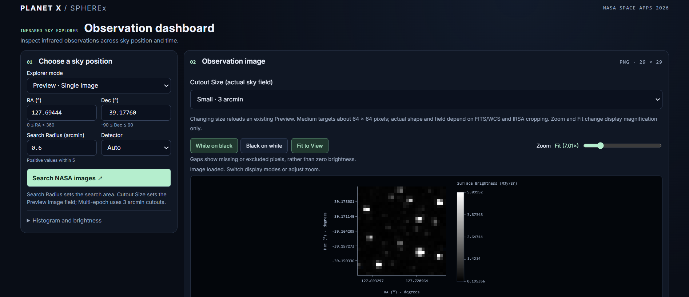
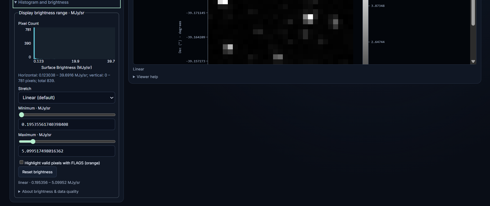
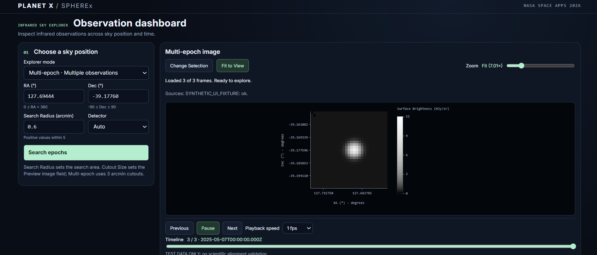

# Planet X & SPHEREx

*An Interactive Web Tool for Exploring SPHEREx Infrared Observations*

Planet X & SPHEREx brings NASA SPHEREx infrared observations into an interactive browser dashboard. Search by sky coordinates, inspect real observation images, adjust brightness visualization, and explore multiple exposures on a shared sky grid.

Built for NASA Space Apps 2026, the project is motivated by Planet X research and the search for potential moving objects. It makes observation imagery, sky coordinates, data quality, and observation times accessible together for visual exploration.

## Live Demo

**[Open the Live Demo](https://zo4j433.github.io/planet-x-spherex/)** · [GitHub Repository](https://github.com/zo4j433/planet-x-spherex)

Choose **Preview** for a single image or **Multi-epoch** to select observations and play a sequence. Live observation searches depend on NASA/IPAC IRSA data services.



*Interactive Preview using real SPHEREx observation data.*

## Key Features

- **Sky-coordinate Search:** Find SPHEREx observations by ICRS RA, Dec, and Search Radius, with optional detector selection. IRSA's Simple Image Access (SIA) service supplies observation metadata and links to FITS cutouts.
- **Interactive Preview:** Inspect infrared images with Zoom, Fit to View, black/white inversion, and observation details. Choose Small (3 arcmin) or Medium (6.5 arcmin) cutouts and view their returned dimensions and sky coverage.
- **Brightness Visualization:** Adjust the brightness range with Linear, Asinh, Log, or Sqrt stretch. The histogram shows original valid pixel values in MJy/sr, and the Color Bar explains the display mapping. Display adjustments preserve scientific values.
- **WCS & Data Quality:** Celestial World Coordinate System (WCS) information connects image positions with sky coordinates. FITS quality flags and finite-value checks identify usable pixels; multi-epoch processing reprojects observations onto a common sky grid. Preview and Multi-epoch apply distinct quality policies, detailed in the [technical review](docs/multi-epoch-visualization-review.md).
- **Multi-epoch Visualization:** Select 2–3 distinct exposures from the same detector, then browse or play frames in observation-time order. Compatible sequences share a brightness scale; other sequences use independent ranges. Compatibility checks consider target wavelength, calibration, relative alignment, and common valid coverage.

### Viewer Examples



*Interactive brightness controls and histogram visualization using real SPHEREx data.*



*Multi-epoch viewer — synthetic UI demonstration.*

## How It Works

The **frontend** uses HTML, CSS, and JavaScript, served through GitHub Pages. It provides the dashboard, image controls, observation selection, and timeline player. Brightness adjustments and playback run in the browser after data is loaded.

The **backend** uses Python and FastAPI, hosted on Render at `https://planet-x-spherex.onrender.com`. It validates requests, queries SIA, processes FITS images, applies quality masks, reprojects multi-epoch frames, and caches rendered results. The shared processing code in `research/` uses Astropy for FITS/WCS, NumPy for numerical arrays, and Pillow for PNG rendering.

**Data source:** NASA/IPAC IRSA SPHEREx observation metadata and infrared FITS products, using the DR1 and QR3 collections.

**Preview**

```text
SIA Search → Candidate Selection → FITS Cutout
           → WCS Validation + Quality Masking → PNG & Metadata → Interactive Viewer
```

The frontend sends `POST /api/preview`, then loads the returned image paths from the API origin. Metadata includes brightness data and WCS information for interactive rendering.

**Multi-epoch**

```text
SIA Metadata Search → User Frame Selection → FITS Validation & Quality Masking
                    → Common-grid WCS Reprojection → Compatibility Checks → Timeline Viewer
```

`POST /api/epochs/search` returns observation candidates without downloading FITS. After selection, `POST /api/epoch-frames` processes the chosen products and returns a sequence manifest with image URLs and display data.

## Quick Start

### Requirements

- Python **3.12**; the project's `.python-version` pins **3.12.14**.
- Node.js **22** (the GitHub Pages CI version) or **24** (verified locally).
- Git and Windows PowerShell for the commands below.
- Internet access for dependency installation and live IRSA searches.

### 1. Clone and install

Run these commands in PowerShell. All subsequent commands use the repository root as their working directory.

```powershell
git clone https://github.com/zo4j433/planet-x-spherex.git
Set-Location .\planet-x-spherex
py -3.12 -m venv .venv
.\.venv\Scripts\python.exe -m pip install -r backend/requirements.txt
```

The backend requirements include the scientific dependencies from `research/requirements.txt`. Calling the virtual environment's Python directly avoids a separate activation step.

### 2. Start the backend — Terminal 1

```powershell
.\.venv\Scripts\python.exe -m uvicorn backend.app.main:app --host 127.0.0.1 --port 8015 --workers 1
```

Keep this terminal running. Check [backend health](http://127.0.0.1:8015/health) or open the [interactive API documentation](http://127.0.0.1:8015/docs).

### 3. Start the frontend — Terminal 2

Open another PowerShell terminal at the repository root:

```powershell
node frontend/tools/serve.mjs
```

No `npm install` is needed. Open **[http://127.0.0.1:5500/planet-x-spherex/](http://127.0.0.1:5500/planet-x-spherex/)**.

Local pages default to the API at `http://127.0.0.1:8015`. If you start Uvicorn on port 8000 instead, use [this development URL](http://127.0.0.1:5500/planet-x-spherex/?devApiOrigin=http://127.0.0.1:8000). The `devApiOrigin` override applies on localhost pages and lasts for that URL; public pages use the Render API.

### 4. Run a sample query

In **Preview**, enter RA **127.69444**, Dec **-39.17760**, and Search Radius **0.6 arcmin**. Leave Detector on **Auto**, then select **Search NASA images**. Explore the image and brightness controls. For a sequence, switch to **Multi-epoch**, search, select 2–3 distinct exposures on the same detector, and choose **Load frames**.

The UI converts arcminutes to the API's `radius_deg`: **0.6 arcmin = 0.01 degrees**. Search Radius selects overlapping observations; Cutout Size controls the requested Preview field. Stop each server with `Ctrl+C`.

## Offline Demo & Fixtures

Offline modes run a local fixture API on **8001** alongside the frontend on **5500**. Stop the existing frontend before starting one of these alternatives, then open:

[http://127.0.0.1:5500/planet-x-spherex/?devApiOrigin=http://127.0.0.1:8001](http://127.0.0.1:5500/planet-x-spherex/?devApiOrigin=http://127.0.0.1:8001)

### Real SPHEREx Preview Replay

Replay saved metadata and PNG images from `research/outputs/`:

```powershell
node frontend/tools/serve.mjs --fixture
```

This requires `metadata.json`, `black-background.png`, and `white-background.png`. To regenerate Preview rendering, brightness data, and WCS axes from the saved real `cutout.fits` and metadata, use:

```powershell
node frontend/tools/serve.mjs --wcs-fixture --python=.venv/Scripts/python.exe --scenario=browse
```

Both modes reuse the saved observation without NASA requests; entered coordinates do not select new data. The WCS fixture pairs real Preview data with synthetic Multi-epoch frames. `research/outputs/` is Git-ignored and must be supplied locally after cloning.

### Synthetic Multi-epoch UI Demo

**Synthetic UI demonstration** — explore observation selection, frame switching, and playback using generated test frames:

```powershell
node frontend/tools/serve.mjs --epochs-fixture --scenario=browse
```

Switch to **Multi-epoch**, search, select frames, and choose **Load frames**. This mode works without downloaded observations. `browse` loads all selected frames with independent brightness ranges; `comparable` simulates the shared-scale interface. Omitting `--scenario` selects `failed`, which demonstrates a partially failed sequence. More scenarios are documented in the [Multi-epoch UI technical report](frontend/phase4-5-report.md); use the current startup URLs above.

### Real Multi-epoch Research Data

Local `research/outputs/phase4-2/` holds real SPHEREx FITS files and research comparison plots. These diagnostics are separate from the synthetic player fixtures, which do not replay that research dataset as a complete observation sequence. See the tracked [research report](research/phase4-2/REPORT.md) and [summary snapshot](research/phase4-2/snapshot-summary.json).

Fixture tools, test source code, and research summaries are tracked in Git. Downloaded FITS, generated research outputs, and browser-test screenshots are ignored; this README's selected screenshots are included in `docs/images/`.

## Limitations & Future Work

- Live searches use IRSA services. Processing uses bounded download sizes, request budgets, a shared processing lock, and capacity-limited in-memory caches; cached results expire or are cleared on restart.
- Preview requests bounded cutouts of 3 or 6.5 arcmin. Returned dimensions and coverage depend on FITS/WCS geometry and IRSA cropping. Zoom changes display magnification.
- Multi-epoch supports 2–3 observations, using 3 arcmin input cutouts and a 29 × 29 ICRS output grid at 6.15 arcsec/pixel.
- Scientific comparison requires attention to wavelength, quality masks, WCS coverage, calibration, and relative alignment. Shared display scales support visual inspection; quantitative variability measurements require additional photometric analysis. Different bandpasses can produce brightness differences unrelated to time variability. Moving-source interpretation also requires the coordinate epoch and observation date.

Future work includes improving data retrieval and processing efficiency, supporting larger image fields and longer sequences, integrating catalog searches through services such as SIMBAD or Gaia, and adding source annotations and visualization tools.

## Technical Documentation

- [Backend API and processing details](backend/README.md)
- [Frontend deployment workflow](frontend/DEPLOYMENT.md) and [Render configuration](backend/DEPLOYMENT.md)
- [WCS, brightness, quality policies, and capacity review](docs/multi-epoch-visualization-review.md)
- [Preview size integration and validation](docs/preview-medium-integration.md)

Deployment and phase reports record earlier verification runs. For current local startup instructions, follow Quick Start above.

## Team, Acknowledgments & References

**Project Team:** Li-Hsin Chu · Pei-Hsin Wu

### AI-Assisted Development

ChatGPT and OpenAI Codex were used to support brainstorming, technical research, software development, debugging, testing, and documentation. The project team directed the implementation, reviewed the results, and validated the application's functionality. Scientific observations are sourced from NASA/IPAC IRSA SPHEREx data products.


### Acknowledgments & References

We thank the NASA SPHEREx mission team and NASA/IPAC IRSA for the observation data, archive services, and technical documentation that support this project. SPHEREx is a joint project of the Jet Propulsion Laboratory and the California Institute of Technology, funded by NASA. This is an independent NASA Space Apps project.

- [NASA SPHEREx Mission](https://science.nasa.gov/mission/spherex/)
- [NASA/IPAC IRSA: SPHEREx Data Access and Data Credits](https://irsa.ipac.caltech.edu/Missions/spherex.html)
- [Official IRSA Tutorial: Introduction to SPHEREx Spectral Images](https://caltech-ipac.github.io/irsa-tutorials/spherex-intro/)
